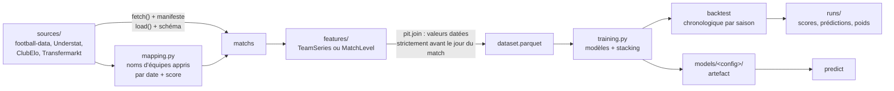

# Orion

[](https://github.com/noushiFlex/orion/actions/workflows/tests.yml)

[English](README.md) · **Français**

Prédiction de matchs de football (probabilités victoire domicile / nul / victoire extérieur et distributions de
scores), conçue pour être mesurée honnêtement face au marché des paris. Features datées sans fuite d'information,
backtests chronologiques, tests anti-fuite, et un historique de versions où chaque changement est évalué sur les
mêmes 6 228 matchs.

<picture>
  <source media="(prefers-color-scheme: dark)" srcset="docs/img/versions-dark.png">
  
</picture>

## Résultats

Cinq grands championnats, saisons de test 2022/23 à 2025/26, 6 228 matchs avec cotes de clôture Pinnacle.
Log-loss du meilleur modèle de chaque version (plus bas = mieux ; répondre toujours 1/3 donne 1,0986).

| Version | Ce qui change | Log-loss | Part de la performance du marché à la clôture |
|---|---|---:|---:|
| v1 | forme glissante, Elo, ClubElo, jours de repos ; Poisson et gradient boosting | 0,9801 | 87,4 % |
| v1.1 | notes attaque/défense en continu, à partir des buts et des xG | 0,9780 | 88,9 % |
| v1.2 | régression logistique multinomiale, GBM régularisé | 0,9769 | 89,7 % |
| v1.3 | cotes d'avant-match comme feature | 0,9687 | 95,8 % |
| v1.4 | poids de l'ensemble appris par stacking | 0,9653 | 98,3 % |
| v1.5 | désaccord entre bookmakers, modèle « marché + correction » | 0,9647 | 98,8 % |
| v1.6 | entraînement sur 22 championnats au lieu de 5 | 0,9644 | 99,0 % |
| v2 | force du onze de départ, d'après les compositions Transfermarkt | 0,9639 | 99,4 % |
| **v2.1** | **titulaires habituels blessés le jour du match** | **0,9635** | **99,7 %** |
| v2.2 – v2.4 | suspensions, ancienneté de l'entraîneur, arbitre et discipline | 0,9636 – 0,9638 | aucun gain |
| v2.5 | 16 championnats hors Europe en données d'entraînement | 0,9637 (ensemble 0,9664) | moins bon |
| *référence* | *moyenne du marché avant clôture* | *0,9655* | *98,2 %* |
| *référence* | *cotes de clôture Pinnacle* | *0,9630* | *100 %* |

Ce qui est prouvé, et ce qui ne l'est pas (tests appariés, intervalle à 95 %) :

- v2.1 bat la moyenne du marché avant clôture : −0,0020 ± 0,0016.
- v2.1 ne bat **pas** les cotes de clôture Pinnacle : +0,0004 ± 0,0021. Orion est au niveau du marché, sans
  avantage démontré.
- v2.2 à v2.5 n'apportent rien de mesurable ; elles restent dans le dépôt, documentées, car un résultat négatif
  reste un résultat.

<picture>
  <source media="(prefers-color-scheme: dark)" srcset="docs/img/calibration-dark.png">
  
</picture>

Écart de calibration (écart moyen |prédit − observé| par tranche de probabilité) : Orion v2.1 0,57 %,
Pinnacle 1,01 %.

## Fonctionnement



- **Aucune fuite d'information par construction.** Les features ne touchent jamais directement les matchs :
  elles renvoient des valeurs avec une date de disponibilité (`available_at`), et `pit.join` n'utilise que les
  valeurs datées strictement avant le jour du match. Des tests vérifient que les features d'un match ne changent
  pas quand on modifie son propre résultat ou un match ultérieur. L'un d'eux a détecté une vraie fuite dans la
  feature arbitre pendant le développement.
- **Évaluation chronologique.** Chaque saison de test est prédite par des modèles entraînés uniquement sur les
  saisons précédentes. Les hyperparamètres et les poids de l'ensemble sont choisis dans la fenêtre
  d'entraînement, jamais sur les saisons de test.
- **Le marché sert de référence.** Chaque modèle est évalué sur les mêmes matchs que les cotes de clôture
  Pinnacle, qui ne sont jamais utilisées en entrée.
- **Modulaire.** Une nouvelle source, feature ou un nouveau modèle tient dans un module avec un décorateur
  `@REGISTRY.register` ; une nouvelle version tient dans un fichier YAML de `configs/`.
- **Traçable.** Chaque fichier brut est haché dans `data/manifest.jsonl` ; chaque exécution enregistre sa
  configuration, son environnement et l'empreinte du dataset dans `runs/`.

## Démarrage rapide

```bash
python -m venv .venv && ./.venv/bin/pip install -e ".[dev]"
./.venv/bin/orion fetch                       # télécharge les données brutes dans data/raw/
./.venv/bin/orion -c configs/orion-v1.6.yaml backtest --rebuild
./.venv/bin/orion -c configs/orion-v1.6.yaml train
./.venv/bin/orion -c configs/orion-v1.6.yaml predict --days 7
./.venv/bin/pytest -q
```

Chaque commande affiche une progression en direct avec le temps restant, puis un tableau de bord dans le
terminal ([exemple](docs/img/dashboard.svg)). Les configurations v2.x nécessitent aussi la base Transfermarkt et
l'historique des blessures (voir `data.md`). Figures du README : `pip install -e ".[docs]"` puis
`python docs/make_figures.py`.

## Données

Aucune donnée n'est incluse dans ce dépôt. Les sources ont leurs propres conditions, plusieurs limitées à un
usage privé ou académique ; `orion fetch` télécharge ce qui peut l'être automatiquement, et `data.md` documente
chaque source, sa couverture et sa licence.

| Source | Utilisée pour |
|---|---|
| [football-data.co.uk](https://football-data.co.uk) | résultats, statistiques de match, arbitres, cotes (22 championnats depuis 2015/16) |
| [Understat](https://understat.com) | expected goals par match (cinq grands championnats) |
| [ClubElo](http://clubelo.com) via [xgabora/Club-Football-Match-Data](https://github.com/xgabora/Club-Football-Match-Data) | classements Elo des clubs |
| [dcaribou/transfermarkt-datasets](https://github.com/dcaribou/transfermarkt-datasets) | compositions, valeurs des joueurs, cartons, entraîneurs |
| [salimt/football-datasets](https://github.com/salimt/football-datasets) | historique des blessures des joueurs |
| [The Open Model](https://theopenmodel.com) | point de comparaison hors échantillon uniquement (CC BY 4.0) |

## Limites

- La meilleure version n'est pas utilisable en direct : les sources Transfermarkt et blessures sont figées
  (juillet et septembre 2026), donc pour les matchs actuels v2.x se comporte comme v1.6.
- Championnats uniquement : pas de coupes, pas de matchs entre divisions, pas de sélections nationales.
- Les preuves hors échantillon au-delà du backtest restent minces (124 matchs de 2026/27 comparés à The Open
  Model).

## Avertissement

Un projet de recherche. Égaler le marché n'est pas un avantage, et rien ici ne constitue un conseil de pari.

## Licence

Code sous [licence MIT](LICENSE). Les données appartiennent à leurs fournisseurs et ne sont pas couvertes par
cette licence.
