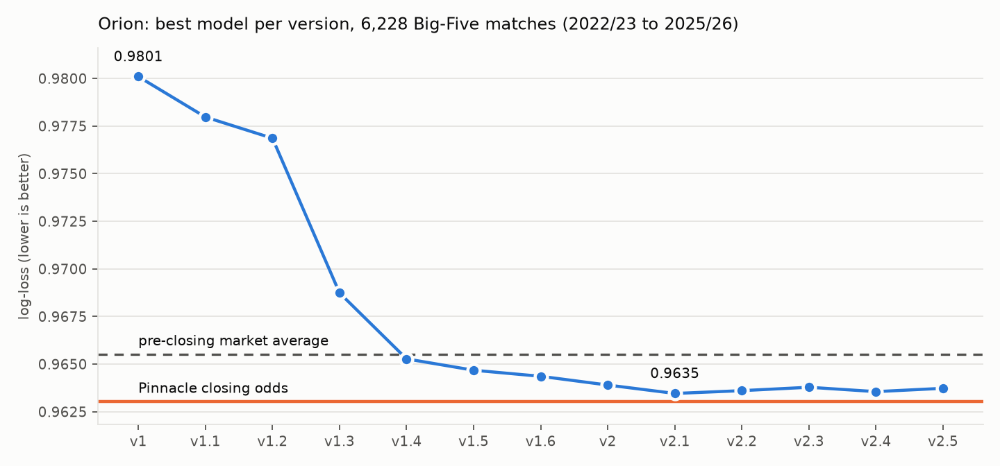
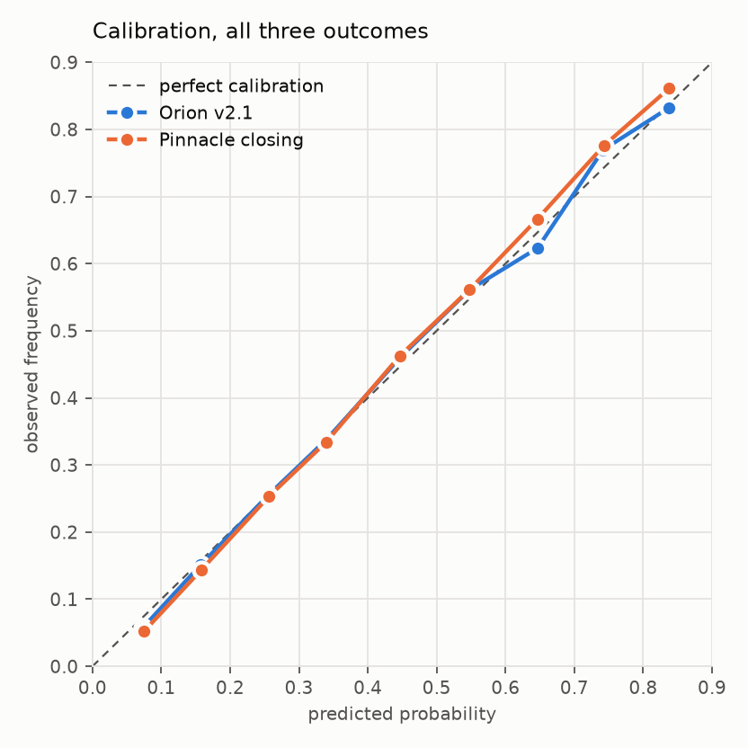
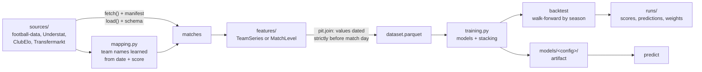

# Orion

[](https://github.com/noushiFlex/orion/actions/workflows/tests.yml)

Football match prediction (home / draw / away probabilities and score distributions), built to be measured
honestly against the betting market. Point-in-time features, walk-forward backtests, leakage tests, and a
version history where every change is scored against the same 6,228 matches.

<picture>
  <source media="(prefers-color-scheme: dark)" srcset="docs/img/versions-dark.png">
  
</picture>

## Results

Big Five leagues, test seasons 2022/23 to 2025/26, 6,228 matches with Pinnacle closing odds. Log-loss of the best
model of each version (lower is better; always guessing 1/3 scores 1.0986).

| Version | What changed | Log-loss | Share of the closing market's skill |
|---|---|---:|---:|
| v1 | rolling form, Elo, ClubElo, rest days; Poisson and gradient boosting | 0.9801 | 87.4% |
| v1.1 | online attack/defence ratings from goals and xG | 0.9780 | 88.9% |
| v1.2 | multinomial logit, regularised GBM | 0.9769 | 89.7% |
| v1.3 | pre-closing market odds as a feature | 0.9687 | 95.8% |
| v1.4 | ensemble weights learned by stacking | 0.9653 | 98.3% |
| v1.5 | bookmaker disagreement, "market + correction" model | 0.9647 | 98.8% |
| v1.6 | trained on 22 leagues instead of 5 | 0.9644 | 99.0% |
| v2 | starting-XI strength from Transfermarkt line-ups | 0.9639 | 99.4% |
| **v2.1** | **injured regulars on match day** | **0.9635** | **99.7%** |
| v2.2 – v2.4 | suspensions, manager tenure, referee and discipline | 0.9636 – 0.9638 | no gain |
| v2.5 | 16 extra non-European leagues as training rows | 0.9637 (ensemble 0.9664) | worse |
| *reference* | *pre-closing market average* | *0.9655* | *98.2%* |
| *reference* | *Pinnacle closing odds* | *0.9630* | *100%* |

What is and is not proven (paired tests, 95%):

- v2.1 beats the pre-closing market average: −0.0020 ± 0.0016.
- v2.1 does **not** beat Pinnacle's closing odds: +0.0004 ± 0.0021. Orion is at market level, with no edge.
- v2.2 to v2.5 add nothing measurable; they stay in the repo, documented, because negative results are results.

<picture>
  <source media="(prefers-color-scheme: dark)" srcset="docs/img/calibration-dark.png">
  
</picture>

Calibration gap (mean |predicted − observed| over probability bins): Orion v2.1 0.57%, Pinnacle 1.01%.

## How it works



- **No leakage by construction.** Features never touch matches directly: they return values with an
  `available_at` date, and `pit.join` only uses values dated strictly before the match day. Tests check that a
  match's features do not change when its own result, or any later match, changes. One of them caught a real
  leak in the referee feature during development.
- **Walk-forward evaluation.** Each test season is predicted by models trained only on earlier seasons.
  Hyperparameters and ensemble weights are chosen inside the training window, never on test seasons.
- **The market is the baseline.** Every model is scored on the same matches as Pinnacle's closing odds, which
  are never used as an input.
- **Pluggable.** A new source, feature or model is one module with a `@REGISTRY.register` decorator; a new
  version is one YAML file in `configs/`.
- **Traceable.** Every raw file is hashed in `data/manifest.jsonl`; every run stores its config, environment and
  dataset fingerprint in `runs/`.

## Quick start

```bash
python -m venv .venv && ./.venv/bin/pip install -e ".[dev]"
./.venv/bin/orion fetch                       # download raw data into data/raw/
./.venv/bin/orion -c configs/orion-v1.6.yaml backtest --rebuild
./.venv/bin/orion -c configs/orion-v1.6.yaml train
./.venv/bin/orion -c configs/orion-v1.6.yaml predict --days 7
./.venv/bin/pytest -q
```

Every command shows live progress with an ETA, then a terminal dashboard ([example](docs/img/dashboard.svg)).
v2.x configs also need the Transfermarkt database and the injury history (see `data.md`). README figures:
`pip install -e ".[docs]"` then `python docs/make_figures.py`.

## Data

No data is included in this repository. Sources have their own terms, several of them for private or
academic use only; `orion fetch` downloads what can be downloaded automatically, and `data.md` documents every
source, its coverage and its licence.

| Source | Used for |
|---|---|
| [football-data.co.uk](https://football-data.co.uk) | results, match stats, referees, odds (22 leagues since 2015/16) |
| [Understat](https://understat.com) | per-match expected goals (Big Five) |
| [ClubElo](http://clubelo.com) via [xgabora/Club-Football-Match-Data](https://github.com/xgabora/Club-Football-Match-Data) | club Elo ratings |
| [dcaribou/transfermarkt-datasets](https://github.com/dcaribou/transfermarkt-datasets) | line-ups, player values, cards, managers |
| [salimt/football-datasets](https://github.com/salimt/football-datasets) | player injury history |
| [The Open Model](https://theopenmodel.com) | out-of-sample benchmark only (CC BY 4.0) |

## Limitations

- The best version is not usable live: the Transfermarkt and injury sources are frozen (July and September
  2026), so for current matches v2.x behaves like v1.6.
- League matches only: no cups, no cross-division ties, no international football.
- Out-of-sample evidence beyond the backtest is small (124 matches of 2026/27 compared with The Open Model).

## Disclaimer

A research project. Matching the market is not an edge, and nothing here is betting advice.

## License

Code under the [MIT License](LICENSE). Data belongs to its providers and is not covered by this licence.
